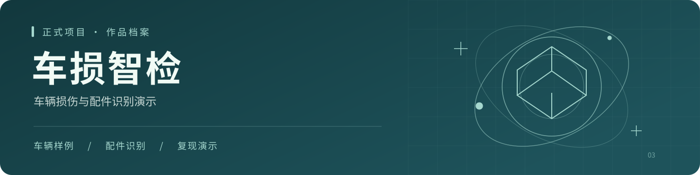
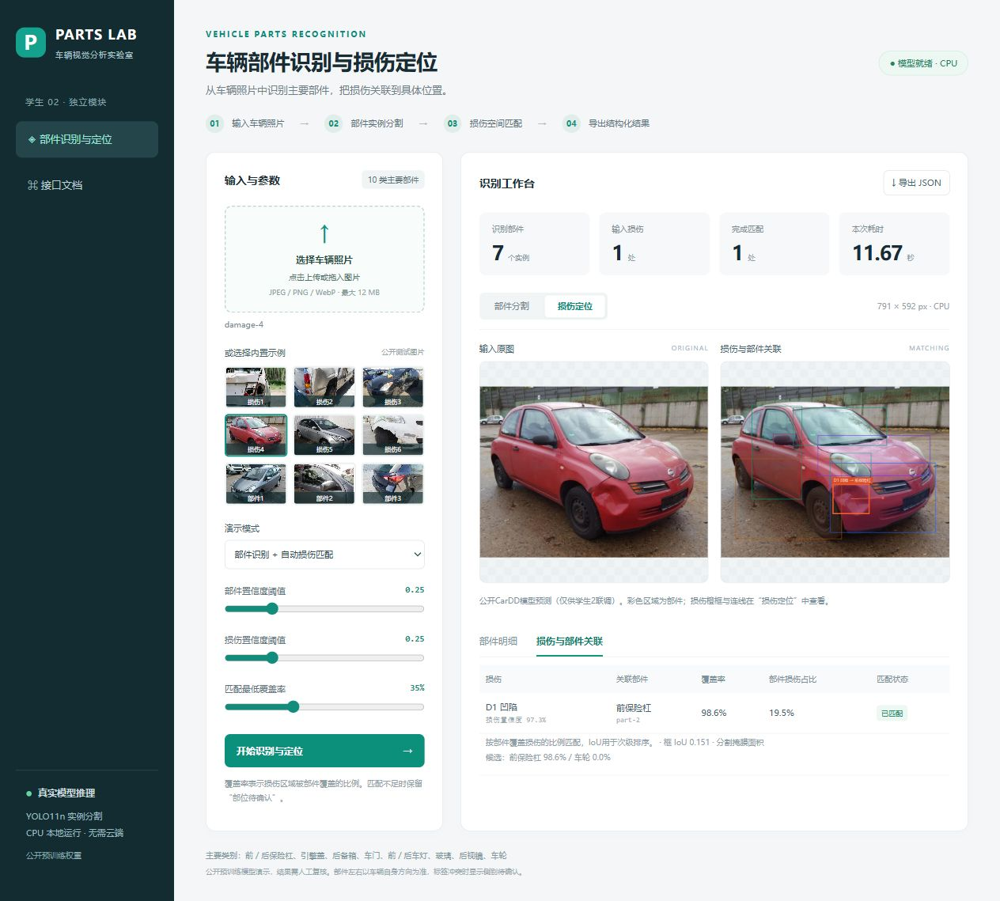

<!-- project-showcase:start -->
<p align="center"></p>
<p align="center"><b>车辆样例 · 配件识别 · 复现演示</b></p>
<p align="center"><a href="#作品画面">看作品</a>　 ·　 <a href="ITERATION_HISTORY.md">历次迭代</a>　 ·　 <a href="https://github.com/qiuyimei/student2-vehicle-parts-demo/archive/refs/heads/main.zip">下载源码</a>　 ·　 <a href="https://github.com/qiuyimei/codex-old-deliverables-20261031#作品图录">全部作品</a></p>

**车损智检** · 车辆损伤与配件识别演示。

## 作品画面

<p align="center"><a href="docs/showcase/preview-01.png"></a><br/><sub>车辆损伤与配件识别演示</sub></p>

## 从这里开始

| 想做什么 | 入口 |
| --- | --- |
| 查看每次迭代、日期与改动 | [历史版本目录](ITERATION_HISTORY.md) |
| 下载当前完整源码 | [当前版本 ZIP](https://github.com/qiuyimei/student2-vehicle-parts-demo/archive/refs/heads/main.zip) |
| 下载发布包、查看已有附件 | [Releases 发布页](https://github.com/qiuyimei/student2-vehicle-parts-demo/releases) |
| 浏览当前工程 | [仓库文件](.) |

<!-- project-showcase:end -->

---

## 使用与项目说明

# 学生2车辆部件识别与损伤定位

本仓库是“基于深度学习的车辆损伤识别与维修建议系统”中学生2的独立模块。输入一张车辆照片，识别车门、保险杠、车灯等部件，再把学生1提供的损伤位置关联到具体部件。

已经实现：10类主要部件展示、公开实例分割模型复现、重复部件合并、左右标签冲突处理、损伤与部件匹配、网页Demo、命令行、FastAPI接口和测试。每一步的操作、命令、预期输出与排查方法见下面的编号教程。


## 先从哪里开始

| 你的目标 | 阅读位置 | 完成后得到什么 |
| --- | --- | --- |
| 理解学生2到底负责什么 | [00 项目与文件导览](docs/tutorial/00-项目与文件导览.md) | 分清部件模型、损伤输入和匹配模块 |
| 第一次拿到工程，安装环境 | [01 从零安装与环境检查](docs/tutorial/01-从零安装与环境检查.md) | Python环境、依赖和校验通过的模型 |
| 把网页与三个独立演示跑通 | [02 网页与命令行演示](docs/tutorial/02-网页与命令行演示.md) | 标注图片、部件列表与JSON结果 |
| 学会整理数据与标注 | [03 数据下载与十类整理](docs/tutorial/03-数据下载与十类整理.md) | 可用于后续训练的10类数据集 |
| 理解模型推理代码 | [04 部件推理代码详解](docs/tutorial/04-部件推理代码详解.md) | 从图片到部件实例的完整调用链 |
| 理解损伤如何关联到部件 | [05 匹配算法逐步计算](docs/tutorial/05-匹配算法逐步计算.md) | 能手算覆盖率、IoU和部件损伤占比 |
| 与学生1、后端同学联调 | [06 接口联调与字段说明](docs/tutorial/06-接口联调与字段说明.md) | 可直接运行的外部输入请求 |
| 复测精度，解释测试结果 | [07 自动测试与指标复现](docs/tutorial/07-自动测试与指标复现.md) | 测试报告、PR曲线与原始模型指标 |
| 后续训练自己的部件模型 | [08 自有模型训练与验证](docs/tutorial/08-自有模型训练与验证.md) | 正确区分训练、验证、测试与部署准备 |
| 学会保存版本与提交工作 | [09 GitHub与成果交付](docs/tutorial/09-GitHub与成果交付.md) | 可追溯的提交、Release与个人成果说明 |
| 遇到问题时定位原因 | [10 常见问题逐项排查](docs/tutorial/10-常见问题逐项排查.md) | 按报错定位到环境、图片、模型或接口 |

建议按00至07依次完成；08是后续自行训练阶段，09用于日常维护，10可随时查阅。已有环境的同学可以直接进入02。

## 最短启动路径

仓库为私有仓库，先用有访问权限的GitHub账号登录。以下命令在Windows PowerShell中执行：

```powershell
git clone https://github.com/qiuyimei/student2-vehicle-parts-demo.git
Set-Location .\student2-vehicle-parts-demo
$env:PYTHONUTF8 = '1'
$pythonPath = py -3.12 -c 'import sys; print(sys.executable)'
powershell.exe -NoProfile -ExecutionPolicy Bypass -File .\setup.ps1 -PythonPath $pythonPath
& .\.venv\Scripts\python.exe scripts/doctor.py --strict
& .\start.ps1
```

浏览器打开 `http://127.0.0.1:8765`，选择“损伤4”，点击“开始识别与定位”。安装、目录、命令和失败处理的完整解释见[01](docs/tutorial/01-从零安装与环境检查.md)；没有`py`命令时，改为传入Python 3.12可执行文件的完整路径。

当前电脑已有上一阶段环境时，双击工程中的`start.cmd`也能运行。克隆到新电脑应先执行安装步骤，不依赖旧电脑目录。

## 下载完整材料

[GitHub Release](https://github.com/qiuyimei/student2-vehicle-parts-demo/releases/latest)提供离线源码与Demo包、整理后的10类部件数据集，以及校验值。

- Git仓库：源码、逐步教程、示例、测试、结果记录与图表。
- Release离线包：包含两份公开模型权重，便于保存和离线运行。
- Release数据包：3,833张公开图片及归并后的10类标签。
- 从Git克隆时：通过`scripts/download_models.py`取得模型，通过`scripts/download_dataset.py`取得可校验的官方原始数据。

## 成果与事实边界

| 项目 | 已完成情况 |
| --- | --- |
| 原始部件模型 | 复现公开YOLO11n实例分割权重；原始23类，排除通用object后归并成10个业务类别 |
| 个人模块代码 | 部件结果封装、重复区域合并、标签冲突处理、损伤关联、接口与演示 |
| 数据整理 | 3,156张训练图、401张验证图、276张测试图，保留公开划分 |
| 初版测试 | 2026年10月15日：25项自动测试、9张样例推理、276张公开标注测试图验证 |
| 教程版检查 | 2026年10月25日：补充数据下载检查，31项自动测试通过 |
| 重新训练 | 本次没有重新训练；训练入口和后续方法已提供 |

公开模型在本地276张测试图上的框mAP50为**71.18%**，Mask mAP50为**71.44%**。这衡量原始23类部件模型，不等于损伤匹配正确率，也不等于归并为10类后的整套Demo准确率。详见[测试报告](docs/测试报告.md)和[原始指标JSON](results/public-model-metrics.json)。

9张演示图得到55个合并后部件实例；21个公开模型生成的损伤输入中，规则接受14个、7个保留未匹配。该数字是运行统计，不是人工真值评估。

## 重要文件

```text
ai/                  部件推理、重复区域处理、损伤匹配、输入验证与接口
web/                 本地网页Demo
examples/            无模型算法例子与真实接口客户端
scripts/             环境检查、模型和数据下载、转换、训练、验证与演示
tests/               单元测试与真实模型API测试
config/              10类数据模板和学生1外部输入例子
docs/tutorial/       从零复现的编号教程
results/             已完成实验的JSON、CSV、图表和标注结果
models/README.md     权重来源、用途和SHA256
```

部件权重来自[Majorburn公开模型](https://huggingface.co/Majorburn/yolov11-carparts-seg)；可选损伤输入来自[CarDD YOLOv8s模型](https://huggingface.co/abdullahg7/cardd-yolov8s)。引用、许可和素材来源保留在[第三方说明](THIRD_PARTY_NOTICES.md)。

