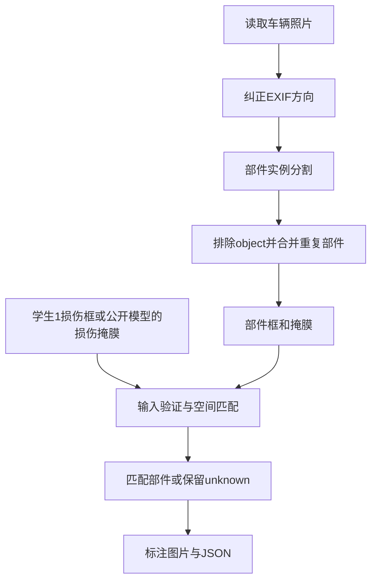

# 00 项目与文件导览

目标是先弄清楚学生2负责的输入、处理和输出，再开始运行命令。完成本章后，应能向其他同学说明“哪些工作由部件模型完成，哪些是自己写的匹配代码”。

## 第一步 明确本模块的任务

学生2主要完成四件事：整理车辆部件类别与标注；运行部件识别模型；把损伤区域关联到部件；保存可核查的演示与测试结果。

例如，照片中有一个凹陷。学生1的损伤识别模块告诉我们凹陷在哪里，学生2识别照片中的保险杠和车门，再计算凹陷与这些部件的重叠关系，输出“该凹陷主要位于前保险杠”。

这个模块没有根据照片计算维修价格，也没有实现整个小程序与业务后台。

## 第二步 分清三个容易混淆的概念

| 概念 | 输入 | 输出 | 本工程中的位置 |
| --- | --- | --- | --- |
| 部件识别 | 车辆照片 | 车门、车灯、保险杠等部件区域 | `ai/pipeline.py`与parts.pt |
| 损伤识别 | 车辆照片 | 凹陷、划痕等损伤区域 | 可选damage.pt，仅供联调 |
| 部件匹配 | 损伤区域与部件区域 | 损伤属于哪个部件、重叠比例及候选 | `ai/matching.py` |

模型输出的矩形叫`bbox`，像素级区域叫`mask`。矩形是包围目标的大致范围；mask能更精确地表示可见部件形状。两种区域不能当作完全相同的面积使用。

## 第三步 读懂运行顺序

`parts`模式在得到部件后直接输出；`external`模式读取学生1的JSON；`auto`模式用公开损伤模型生成输入。三者共享学生2的部件识别逻辑。

## 第四步 按调用链找到文件

从网页进入时，`web/app.js`把照片和参数传到`POST /api/predict`；`ai/server.py`验证图片和JSON；`Pipeline.predict`执行模型和后处理；`matching.py`给出关联；前端展示服务器生成的图片和字段。

从命令行进入时，`scripts/run_demo.py`直接调用同一条`Pipeline.predict`，所以不用启动网页也能演示个人模块。

单独学习匹配算法时，执行`examples/match_without_model.py`。它只需要NumPy，输入是明确写在代码里的教学矩形，不能当成模型实验结果。

## 第五步 明确10类与23类的关系

随附的公开部件模型有23个原始标签，其中包含通用`object`。工程保留原始细分类用于解释，并在展示与数据整理中归并为10类：前保险杠、后保险杠、引擎盖、后备箱或尾门、车门、前车灯、后车灯、玻璃、后视镜、车轮。

“10类业务展示”不表示已经训练了新的10类模型。新训练需要使用10类标签数据重新执行训练，并用同样的10类测试标签评价，不能直接套用原始23类的指标。

## 第六步 建立自己的完成记录

每完成一章，记录运行日期、使用的命令、关键输出、是否成功以及一个真实失败案例。建议保存在`results/tutorial-runs/`或自己的实验记录中。该目录默认不自动提交到Git，确认内容后再有选择地保存。

本章验收：能够说明学生2的输入与输出，指出匹配函数位置，并说清公开预训练模型与自己编写的处理代码之间的区别。

下一步：[01 从零安装与环境检查](01-从零安装与环境检查.md)。
